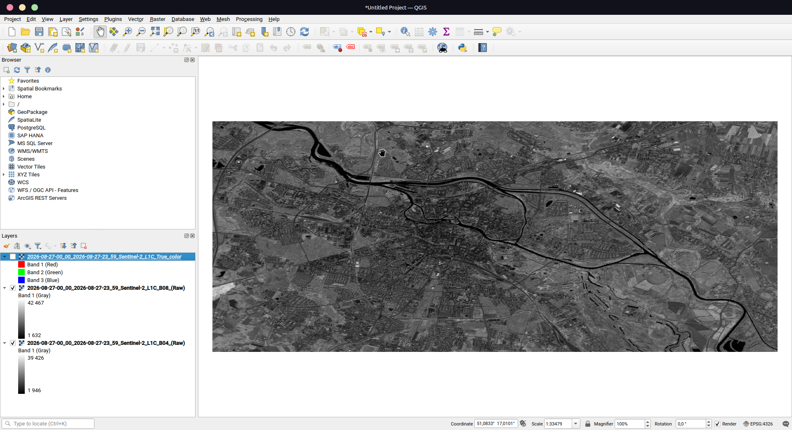
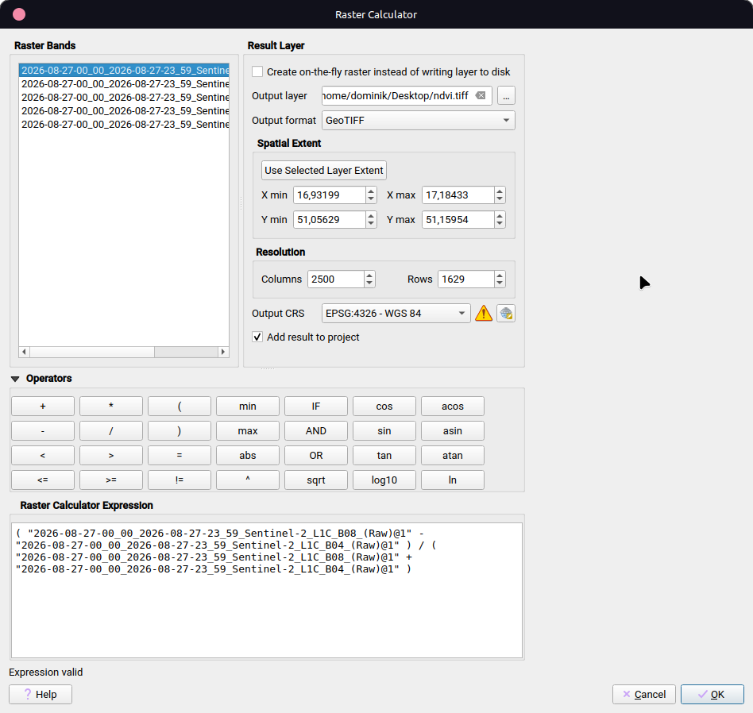
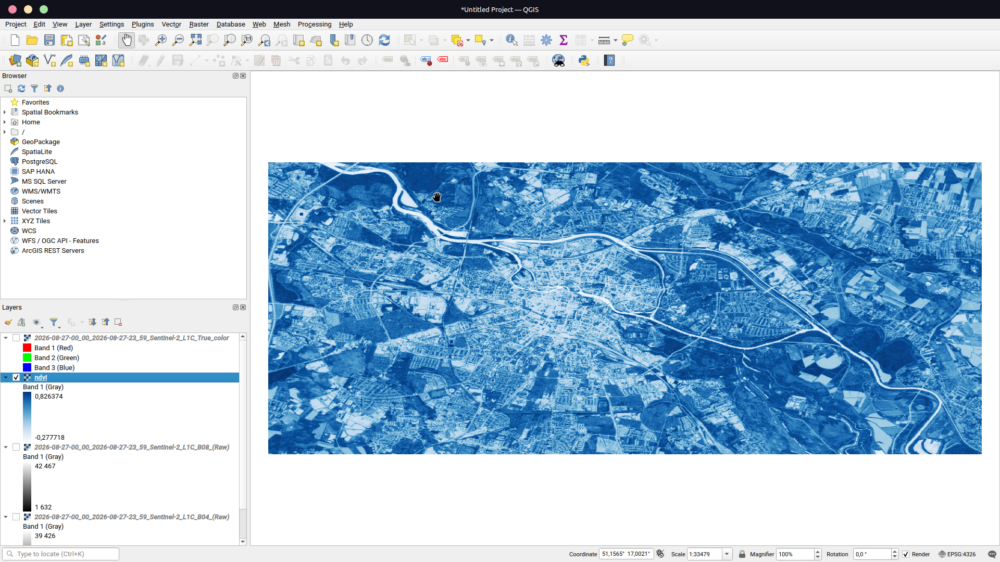

# Laboratorium 1 — Obliczenie wskaźnika NDVI z danych Sentinel-2 w QGIS

## 1. Cel ćwiczenia

Celem ćwiczenia było przygotowanie danych rastrowych Sentinel-2 w programie QGIS, obliczenie wskaźnika **NDVI** (*Normalized Difference Vegetation Index*) na podstawie pasma czerwonego (B04 - Red) oraz pasma bliskiej podczerwieni (B08 - NIR), a następnie wizualizacja i kontrola wyniku.

## 2. Wykorzystane oprogramowanie i dane

- **QGIS** - oprogramowanie do pracy z danymi geoprzestrzennymi.
- **Sentinel-2 B04 (Red)** - pasmo czerwone.
- **Sentinel-2 B08 (NIR)** - pasmo bliskiej podczerwieni.
- **Format pliku wynikowego:** GeoTIFF (`ndvi.tif`).

## 3. Przebieg ćwiczenia - instrukcja krok po kroku

### Krok 1. Uruchomienie QGIS i przygotowanie projektu

1. Uruchom program QGIS.
2. Utwórz nowy projekt.
3. Sprawdź, czy widoczny jest panel **Warstwy (Layers)**, w którym będą wyświetlane dodane rastry.
4. Opcjonalnie zapisz projekt przez **Projekt → Zapisz jako**.

### Krok 2. Dodanie pasm Sentinel-2

1. Dodaj do projektu pliki rastrowe pasma **B04 (Red)** i **B08 (NIR)**.
2. Możesz przeciągnąć pliki z menedżera plików do okna QGIS albo skorzystać z narzędzia dodawania warstwy rastrowej.
3. Sprawdź, czy oba rastry są widoczne w panelu **Warstwy**.

Pasmo B04 reprezentuje zakres czerwony, a B08 - bliską podczerwień. Oba pasma są potrzebne do obliczenia NDVI.



*Rys. 1. Zaimportowane pasma Sentinel-2 wykorzystywane do obliczenia NDVI.*

### Krok 3. Otwarcie Kalkulatora rastra

1. Z górnego menu wybierz **Raster → Kalkulator rastra**.
2. W oknie narzędzia sprawdź listę dostępnych warstw.
3. Przygotuj wyrażenie obliczeniowe opisane w kolejnym kroku.

### Krok 4. Wprowadzenie wzoru NDVI

Wskaźnik NDVI oblicza się według wzoru:

\[
NDVI = \frac{NIR - RED}{NIR + RED}
\]

Dla pasm Sentinel-2 B08 i B04 wyrażenie ma postać ogólną:

```text
("B08@1" - "B04@1") / ("B08@1" + "B04@1")
```

W Kalkulatorze rastra zastąp przykładowe nazwy `B08@1` i `B04@1` dokładnymi nazwami warstw widocznymi na liście w swoim projekcie. Zachowaj nawiasy oraz kolejność odejmowania i dodawania.



*Rys. 2. Wyrażenie NDVI wprowadzone w Kalkulatorze rastra.*

### Krok 5. Ustawienie pliku wynikowego i wykonanie obliczenia

1. W polu pliku wyjściowego wskaż lokalizację zapisu.
2. Ustaw nazwę pliku wynikowego na `ndvi.tif`.
3. Jeśli narzędzie udostępnia ustawienia zasięgu lub rozdzielczości, sprawdź je i pozostaw zgodne z rastrami wejściowymi, o ile instrukcja laboratoryjna nie wymaga inaczej.
4. Uruchom obliczenie przyciskiem uruchomienia lub zatwierdzenia.
5. Po zakończeniu sprawdź, czy w panelu Warstwy pojawiła się nowa warstwa wynikowa.

### Krok 6. Wyświetlenie i wizualizacja warstwy NDVI

1. W panelu **Warstwy** włącz widoczność warstwy `ndvi`.
2. W razie potrzeby wyłącz widoczność rastrów wejściowych, aby wyraźnie zobaczyć wynik.
3. Dopasuj widok do zasięgu rastra.
4. Sprawdź legendę warstwy i widoczny zakres wartości.
   


*Rys. 3. Wizualizacja wynikowej warstwy NDVI w QGIS.*

## 4. Wynik i interpretacja

W wyniku obliczeń utworzono rastrową warstwę `ndvi`. Na dostępnym zrzucie ekranu legenda warstwy pokazuje zakres wartości od około **−0,277718 do 0,826374**. Wizualizacja przedstawia przestrzenne zróżnicowanie wartości wskaźnika NDVI na analizowanym obszarze.

Ogólnie wartości NDVI bliższe 1 są typowe dla gęstej, aktywnej roślinności. Wartości w pobliżu 0 mogą odpowiadać powierzchniom o niewielkiej ilości roślinności, natomiast wartości ujemne mogą występować między innymi dla wody lub niektórych powierzchni nieporośniętych. Interpretując konkretne miejsca, należy uwzględnić charakter terenu i jakość danych.

## 5. Wnioski

Ćwiczenie obejmowało dodanie pasm wejściowych Sentinel-2 do QGIS, zastosowanie Kalkulatora rastra, zapis wyniku do pliku GeoTIFF oraz wizualizację wskaźnika NDVI. Otrzymana warstwa pozwala analizować przestrzenne zróżnicowanie odbicia w paśmie czerwonym i bliskiej podczerwieni, co może być wykorzystywane do oceny rozmieszczenia i kondycji roślinności.
